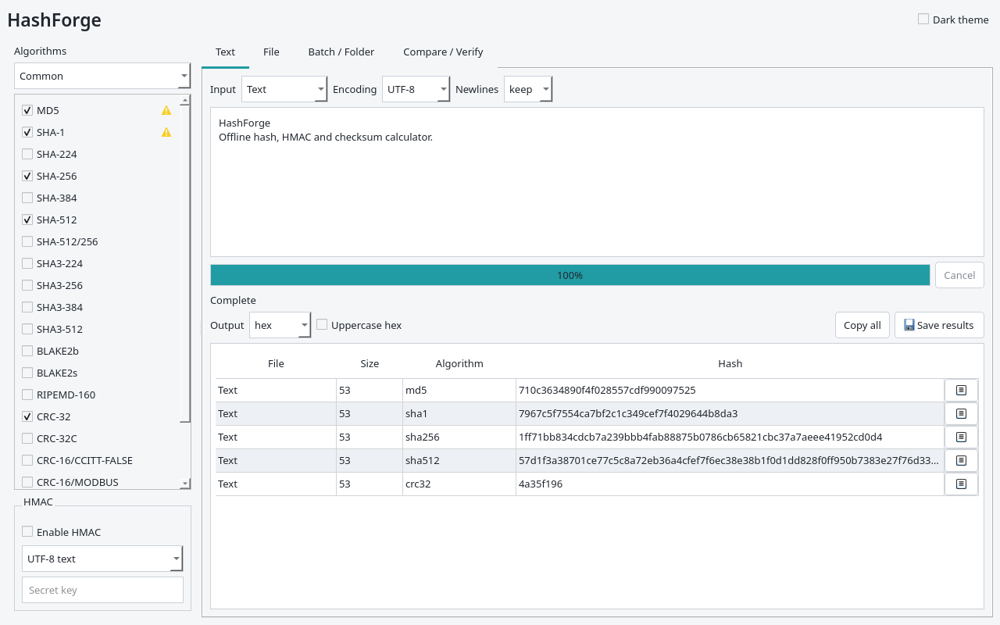
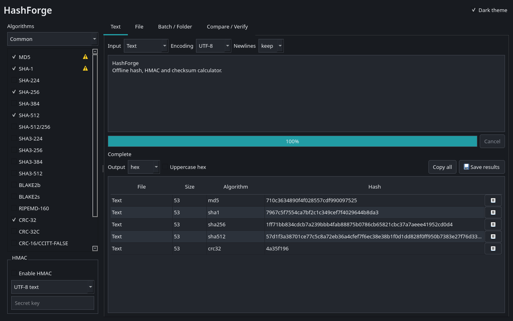
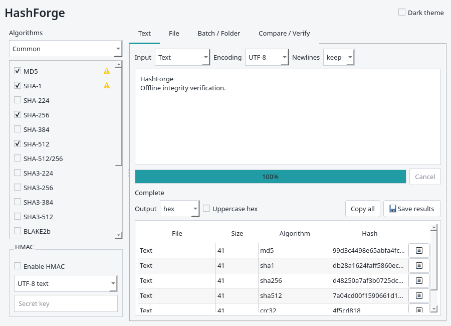

# HashForge

Offline hash, HMAC, and checksum calculator for Python 3.11+ and PySide6.
Development and tests run on Linux and Windows. Windows executables must be
built on Windows: PyInstaller does not cross-compile.

## Development

Create a virtual environment with Python 3.11 or newer, activate it, and run:

```sh
python -m pip install -r requirements.txt
python -m pytest
python main.py
```

Tests select `QT_QPA_PLATFORM=offscreen` before importing test modules. Both
build scripts and CI also set this variable explicitly, so GUI tests require
no display server. The application has no network clients or telemetry.

## Desktop Usage

- **Text:** enter text, hex, or strict Base64. Choose the text encoding and
  newline policy; results update after a 200 ms pause. The editor represents
  paragraphs as LF, and CRLF converts these to Windows line endings.
- **File:** browse, enter a path, or drop any file onto the File tab. All
  selected algorithms process the same raw bytes in one streaming pass.
  Progress includes throughput and ETA; Cancel stops work cooperatively.
- **Batch / Folder:** select multiple files or a directory and optionally
  enable recursion. Successful results remain available when individual files
  fail. Directory symlinks are not followed.
- **Compare / Verify:** paste a hexadecimal digest and select a file or the
  Text tab. Digest length can identify several candidates; select the expected
  algorithm before verification. Comparison uses `hmac.compare_digest`.

Select algorithms individually or use Common, Network/Forensics, or All.
HMAC accepts UTF-8, hex, or Base64 keys. It replaces cryptographic hash results
with HMAC results; checksums remain unkeyed. Empty keys are rejected. Keys and
input contents are not saved in settings. Theme, window geometry, and algorithm
selection, input encoding, newline policy, key encoding, and recursive-folder
preference are remembered locally with QSettings. HMAC enablement and secret
keys are deliberately not restored.

Results support lowercase/uppercase hex, Base64, and decimal for checksums.
Use each row's copy button, Copy all, or Save results for TXT, CSV, JSON, and
checksum manifests. Exports use canonical lowercase hex plus Base64 and decimal
fields in CSV/JSON. Manifest export prompts for one ordinary hash algorithm and
writes paths relative to the manifest directory. Run `sha256sum -c checksums.sha256`
from that directory. HMAC and checksum results cannot be exported as hash manifests.

Files use bounded 4 MiB reads. Custom table-driven CRCs are implemented in pure
Python, so selecting all CRC algorithms reduces throughput on large files.
Files modified or removed during hashing are reported as errors. MIME labels
are best-effort guesses and never influence the bytes being hashed.

## Command Line

```sh
python main.py --file capture.pcap --algo sha256,md5 --format json
python -m hashforge --text abc --algo sha256 --format json
python main.py --text "Hi There" --algo sha256 --hmac-key secret --format json
```

Use `--key-mode hex` or `--key-mode base64` for encoded HMAC keys, and
`--input-mode hex` or `--input-mode base64` for encoded text input. `--output`
writes results directly to a file. `--hmac-key-env VARIABLE` reads a key from
an environment variable. Command-line secret arguments may appear in shell
history; the GUI key field avoids that. `--list-algorithms` reports available
algorithm IDs. `--verify HEX` requires one algorithm and returns exit code 0
for a match and 1 for a mismatch or calculation error. Argument syntax errors
return 2.

The Windows executable is windowed, so use an output file for reliable CLI
results even when no console is attached:

```bat
HashForge.exe --file capture.pcap --algo sha256,md5 --format json --output results.json
```

Use `--help` from the Python CLI for all options. Failures return a nonzero exit code.

## Windows Build

Install Python 3.11 with the Windows Python launcher, then run:

```bat
build.bat
```

The script creates `.venv`, installs requirements, runs tests, and builds
with `hashforge.spec`. The default is `onedir`: launch
`dist/HashForge/HashForge.exe` and distribute the entire `dist/HashForge`
directory, including its dependency files.

For a single executable at `dist/HashForge.exe`:

```bat
build.bat --onefile
```

`build.bat --onedir` explicitly selects the default mode. The spec uses
`assets/icon.ico` and `assets/version_info.txt` for Windows builds when those
assets are present. Unsigned PyInstaller executables may trigger antivirus
false positives. Release signing can help establish publisher identity;
report false positives to the antivirus vendor instead of disabling protection.

## Linux Build

With Python 3.11+ and its `venv` support installed:

```sh
bash build.sh
bash build.sh --onefile
```

The default produces `dist/HashForge/HashForge` with its dependencies in the
same directory. The optional single-file mode produces `dist/HashForge`.
These are Linux binaries for local testing, not Windows executables. Build
dependencies must be installed or available in a local package cache; the
application itself operates offline.

Use a clean checkout or remove the previous `dist/HashForge` output before
switching Linux packaging modes, since that path changes from a directory to
a file. The scripts stop when tests or packaging fail.

## Continuous Integration

`.github/workflows/build-windows.yml` runs on pushes, pull requests, and manual
dispatches. A separate `ubuntu-latest` job runs the tests. The `windows-latest`
job uses Python 3.11, installs requirements, runs tests headlessly, and builds
with `hashforge.spec`.

Download `HashForge-windows-onedir` from the workflow's artifacts and extract
the entire archive before launching `HashForge.exe`. To obtain a single-file
executable, run the workflow manually with `mode` set to `onefile` and download
`HashForge-windows-onefile`, which contains `dist/HashForge.exe` from the build.
Push and pull-request builds use `onedir` by default. Artifacts are retained
for 14 days.

## Supported Algorithms

- MD5; SHA-1; SHA-224, SHA-256, SHA-384, SHA-512, SHA-512/256.
- SHA3-224, SHA3-256, SHA3-384, SHA3-512; BLAKE2b and BLAKE2s.
- RIPEMD-160 when available in the local OpenSSL runtime.
- HMAC with each available cryptographic hash.
- CRC-32, CRC-32C, CRC-16/CCITT-FALSE, CRC-16/MODBUS, CRC-64/ECMA,
  and Adler-32.

## Usage Screenshots

### Light Theme



### Dark Theme



### Compact Window



Regenerate screenshots with `python tools/capture_screenshots.py`. The
application icon can be regenerated offline with `python tools/generate_icon.py`.
Icon regeneration requires the optional Pillow dependency in
`requirements-dev.txt`; the committed icon is ready to package.

## Validation and Architecture

`hashforge/core/` contains the GUI-independent registry, streaming hashers,
CRC implementations, file inspection, and serializers. `hashforge/gui/`
contains Qt widgets and cancellable QThread jobs. The CLI uses the same core
and does not import Qt when invoked with arguments.

Tests include fixed `abc`, empty-input, and million-`a` cryptographic vectors;
the empty and long fixtures were independently cross-checked with OpenSSL.
RFC 2202 and RFC 4231 cover HMAC, while CRC catalogue check values use
`123456789`. A separate bit-at-a-time reference checks custom CRCs on empty,
short, and long binary messages. GUI tests exercise live updates,
verification, batch failures, and cancellation during window shutdown.
Manifest compatibility is checked with `sha256sum -c` when available.

The application never uploads input or performs network requests. Dependency
installation and optional CI builds may access package repositories. For an
offline build, preinstall requirements from a local wheelhouse (or set pip's
`PIP_NO_INDEX` and `PIP_FIND_LINKS` environment variables). No optional hash
libraries are needed.
